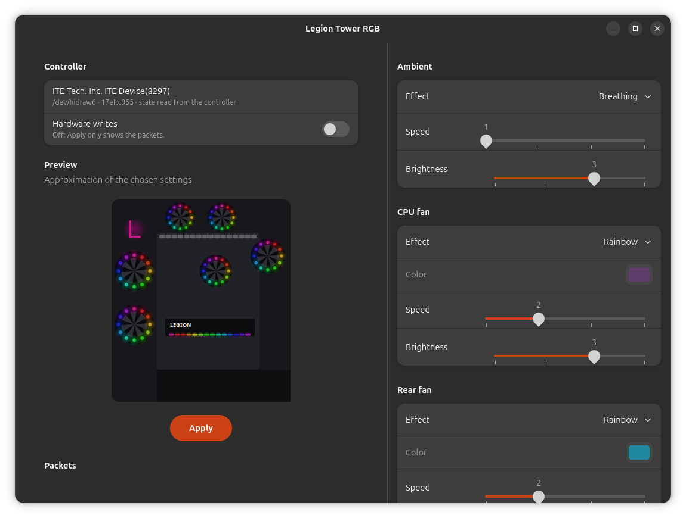

# Legion Tower RGB

Control the fan, ambient, logo and GPU lighting of Lenovo Legion Tower desktops
on Linux, the part Lenovo Vantage handles on Windows. Python, GTK4/libadwaita GUI and CLI.

> **Status: early development.** The protocol comes from USB captures of
> Lenovo Vantage on a Legion T5 26ARA8 and is only partly mapped. Every front end runs in
> **preview mode by default**: it shows the packets it would send and sends
> nothing until you explicitly enable hardware writes.



## Supported hardware

| Model | Controller | Zones |
|---|---|---|
| Legion T5 26ARA8 (MT 90UY) | ITE IT8297, USB `17ef:c955` | ambient, logo, 6 fans (CPU, rear, 2 front, 2 top), all 12 effects |
| Lenovo OEM RTX 4070 SUPER (`17aa:e138`) | GPU MCU at I2C `0x49` | strip (off, static, flicker, breathing, rainbow) and wordmark |

## Install

Debian / Ubuntu: download the `.deb` from the
[releases](https://github.com/codingkoala/legion-tower-rgb/releases) and

```sh
sudo apt install ./legion-tower-rgb_*_all.deb
```

It pulls in GTK4/libadwaita and installs the udev rule that gives the desktop
user access to the lighting controller and the GPU's I2C port.

From source:

```sh
sudo apt install python3-gi python3-gi-cairo gir1.2-gtk-4.0 gir1.2-adw-1
pip install --user .
sudo ./install-udev.sh   # only needed for hardware writes
```

Build the package yourself with `packaging/build-deb.sh` (needs only `dpkg-deb`).

## Usage

```sh
legion-tower-rgb                                         # GUI
legion-tower-rgb-cli detect                              # reads sysfs only
legion-tower-rgb-cli status                              # reads the state from the controller
legion-tower-rgb-cli report                              # hardware facts for a new-model issue
legion-tower-rgb-cli set all breathing --color 00aaff    # dry run
legion-tower-rgb-cli set cpu-fan static --write          # really sends
legion-tower-rgb-cli gpu breathing --color 0000ff --speed 4 --write
```

## Documentation

- [Feasibility study](docs/FEASIBILITY.md)
- [Protocol notes](docs/PROTOCOL.md)
- [GPU lighting](docs/GPU.md)
- [Adding a new model](docs/NEW_MODEL.md)
- [Reverse-engineering plan](docs/REVERSE_ENGINEERING.md)

## Credits

Early protocol hints from [OpenRGB](https://gitlab.com/CalcProgrammer1/OpenRGB)'s
`LenovoMotherboardController` (GPL-2.0-or-later). This project reimplements
them; no OpenRGB code is copied.

## License

GPL-3.0-or-later. Not affiliated with or endorsed by Lenovo.
